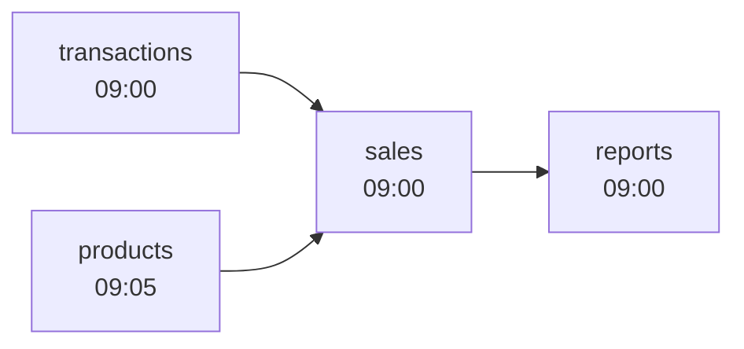
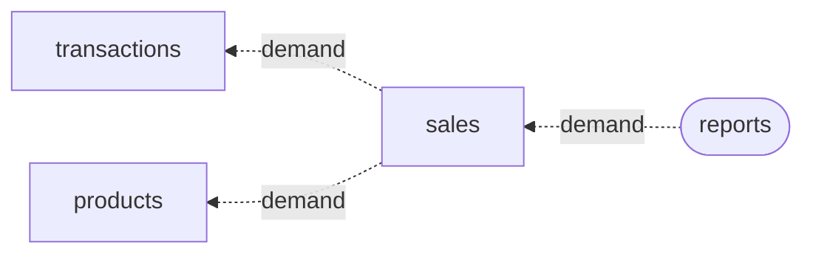
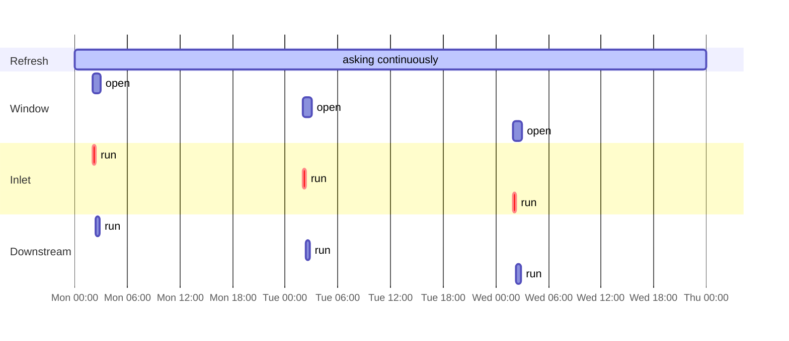

# Orchestration

Duckstring doesn't run Ponds on schedules. Instead, you ask for the data you need with a Refresh on the Pond that holds it, usually an Outlet, and Duckstring works backwards to decide what upstream has to run. A Pond that nothing downstream is asking for never runs.

<video autoplay loop muted playsinline style="width: 100%; border-radius: 8px;" aria-label="The demo pipeline in the web UI under a continuous Refresh on reports">
  <source src="/img/ripple.webm" type="video/webm" />
  <source src="/img/ripple.mp4" type="video/mp4" />
</video>

The demo pipeline in the web UI, kept current by a continuous Refresh on `reports`.

The [Playground](https://playground.duckstring.com) runs the same pipeline in your browser, with nothing to install. A short guided tour walks through the main ideas on this page as the pipeline runs, and afterwards you can change step durations, add Ponds and try different Refreshes yourself.

## Structure

The same rules apply at two levels: between Ponds, following the dependencies in `pond.toml`, and between the Ripples inside each Pond. A Pond starts a run when it has been asked for data and its Sources have something newer to give it. There is no limit on how many Pond Runs happen at once, so a Pond can be working on a new run while its downstream Ponds are still processing the previous one.

## Freshness and Demand

### Why pull

Most orchestrators push. A schedule starts the pipeline at its beginning, and each step triggers the next when it finishes. This works well for small pipelines, but it causes problems as they grow:

- Every path runs whether or not anything uses its output. A table nobody reads any more keeps costing compute until someone notices and takes it off the schedule.
- Deploying something new means deciding when it should run and fitting it around everything else, and a mistake can disrupt steps that were already working.
- Fast steps run as often as they can, even when a slower step downstream can only use a fraction of their output.

Duckstring pulls instead. Demand starts at the end of the pipeline and travels upstream, and a Pond runs only when something downstream has asked for its data. As a result, unused paths go quiet on their own. Deploying is also safe: a new Pond, or a new major version of an existing one, sits idle until a consumer is pointed at it, so a deployment never changes what already runs. And, as described below, the whole pipeline settles at the pace of its slowest step, upstream of that step as well as downstream.

### Freshness

To decide whether a Pond needs to run, Duckstring needs a way to say how current its data is. Every Pond has a **freshness**: the point in time its data reflects. For an Inlet, this is the time the data was requested. For any other Pond, it is the freshness of its oldest Source, since the output can't be more current than its oldest input.

A Pond has new data to offer its downstream Ponds whenever its freshness is later than the data they last used.

### How demand travels

A **Refresh** asks a Pond for data at least as fresh as the moment it was sent. The request travels upstream to the Pond's Sources, and on to theirs, until it reaches the Inlets. Every Pond along the way whose data is older than requested runs, the Inlets first, and the new data then flows back down. From an idle pipeline, a Refresh on `reports` reaches both Inlets:

<!-- DIAGRAM: step-by-step version of the above (idle → demand travelling up → Inlets running → sales running → reports running). Possibly better as a short video from the web UI. -->

The whole pipeline reaches one freshness: each Inlet stamps its data with the time of the Refresh, so `reports` ends up exactly as fresh as the moment it was asked.

### Throttling to the bottleneck

Requests can arrive faster than the pipeline can serve them, for example from a Refresh that repeats more often than the slowest step can run. Take a chain `A` (1 second) → `B` (3 seconds) → `C` (1 second), with `C` refreshed continuously. If every request went straight upstream, `A` would run three times for each run of `B`, and two of those results would be thrown away.

Duckstring notices when a step can't keep up: it is one that receives a second request during a single run. It then holds requests there and sends one upstream each time that step starts a new run, so the steps before it run once per run of the slowest step:

```mermaid
gantt
    dateFormat X
    axisFormat %S
    section Unpaced: A
    run      :0, 1
    run      :1, 2
    wasted   :crit, 2, 3
    wasted   :crit, 3, 4
    run      :4, 5
    wasted   :crit, 5, 6
    wasted   :crit, 6, 7
    section Paced: A
    run      :0, 1
    run      :1, 2
    run      :4, 5
    section B
    run      :1, 4
    run      :4, 7
    section C
    run      :4, 5
    run      :7, 8
```

Every step runs once per 3 seconds, the duration of `B`. In the Quickstart demo the slowest step is `join_lines` at 3 seconds, so under a continuous Refresh every Pond settles to running about every 3 seconds, with no work produced that nothing uses. Occasional Refreshes aren't affected, and nothing needs configuring: the pacing follows the pipeline as it is, and adapts when a step's run time changes.

The [Playground](https://playground.duckstring.com) tour shows this on the same pipeline: under a continuous Refresh on `reports`, every Ripple settles to running every 3 seconds, and the pipeline keeps pace when the duration of `join_lines` starts to vary.

### Skipping unchanged work

If none of a Pond's Sources has changed since its last run, Duckstring skips the run and passes the new freshness through without recomputing anything.

Only an Inlet can see whether the outside world has changed, so an Inlet always runs. When it finds nothing new, for example an export file that hasn't been replaced since the last run, it can mark its run as producing no change. The Ponds downstream of it then pass in turn without running, so a pipeline with nothing new to process costs only its Inlet runs. Any other Pond can mark a run the same way when it recomputes and finds its output is the same. This is always the Pond's own decision, because a Pond that calls an API or sends a report may need to run even when its tables wouldn't change.

Each table and Object a Pond publishes also records when it last changed, so a Pond that does run can skip just the work that depends on an unchanged input. If `transactions` changed but `products` didn't, `sales` can recompute its daily totals and keep its price tiers as they were.

## Refreshes

A Refresh can be sent once, or kept standing so it repeats. Refreshes are set with `duckstring refresh` or from the web UI:

| Refresh | Command | Asks for |
|---|---|---|
| Now | `duckstring refresh reports` | data at least as fresh as now, once |
| Every | `duckstring refresh add reports --every 1d` | a Refresh once a day has passed since the last request or refresh |
| At set times | `duckstring refresh add reports --every 1d --start 06:00` | a Refresh at 06:00 each day |
| Continuous | `duckstring refresh add reports --continuous` | data as fresh as the pipeline allows |

`--every` is how you run something daily. The day counts from the later of the last request and the last refresh of the data, so any other refresh of `reports` moves it on, and `reports` is never more than a day plus the pipeline's run time old. When the time of day matters, `--start` pins the Refresh to a schedule instead: it asks at 06:00 whatever else has refreshed the Pond, and the data is labelled 06:00. A scheduled Refresh can be limited to certain weekdays and given an end date.

A Pond can have any number of scheduled Refreshes and one `--every` or continuous Refresh; adding another of those replaces it. A continuous Refresh is paced to the slowest step as described above, so it keeps the data as fresh as the pipeline can make it without running anything twice.

Refreshes can be placed on any Pond, but we strongly recommend placing them only on Outlets. Demand then always comes from something that genuinely consumes the data, and every Pond upstream runs only as often as its consumers need.

A Pond can also take a Source as optional, using whatever that Source has published without waiting for it. A Refresh builds an optional Source once, so there is something to read, but doesn't refresh it after that. If an optional Source needs to stay current, give it a Refresh of its own.

You can try Refreshes in the [Playground](https://playground.duckstring.com), on the demo pipeline or on one you build. A Refresh more frequent than the slowest step shows the pacing.

## Taps

Some data only needs to be fresh while someone is using it, such as a dashboard opened a few times a day. A **Tap** gives an app its own key for reading a Pond, with a limit on how old the data may be. A query through the Tap refreshes the Pond when its data is older than that, so the pipeline keeps up while the app is in use and goes quiet when it isn't, with no schedule to tune. Queries from anywhere else, such as the web UI or a notebook, never cause a run. See [Serving Apps with Taps](../guides/serving_apps_with_taps.md).

## Windows

Some Inlets read from systems that only update at certain times, such as a warehouse export that lands once a night. Running them more often wastes compute and adds nothing. A **window** declares when an Inlet can produce new data, for example every day from 02:00 for one hour. The Inlet runs at most once per window, and never between windows. Its data is treated as fresh until the end of the window, so downstream demand doesn't ask for more until the next one opens.

Windows are set on the Catchment with `duckstring window`, not in `pond.toml`, since they describe the environment rather than the code.

Here an Inlet has a window from 02:00 to 03:00 each day, and a continuous Refresh on an Outlet downstream asks for data all the time. The Inlet runs once as each window opens, the run flows downstream, and the demand waits in between:

## Standard Patterns

| Need | Setup |
|---|---|
| A report ready every morning | a Refresh every `1d` from `06:00` on the report's Outlet |
| Data at most a day old | a Refresh every `1d` on the Outlet |
| A dashboard kept as current as possible | a continuous Refresh on the dashboard's Outlet |
| An app that needs current data while it's in use | a Tap on the app's Outlet |
| An upstream source that updates nightly | a window on its Inlet, plus any Refresh downstream |

## See also

- Guides: [Scheduling](../guides/scheduling.md), [Serving Apps with Taps](../guides/serving_apps_with_taps.md), [Monitoring and Failures](../guides/monitoring_and_failures.md)
- Reference: [duckstring refresh](../reference/cli/refresh.md), [duckstring tap](../reference/cli/tap.md), [duckstring window](../reference/cli/window.md), [duckstring control](../reference/cli/control.md)
- [Playground](https://playground.duckstring.com): this model simulated in the browser, with a guided tour
