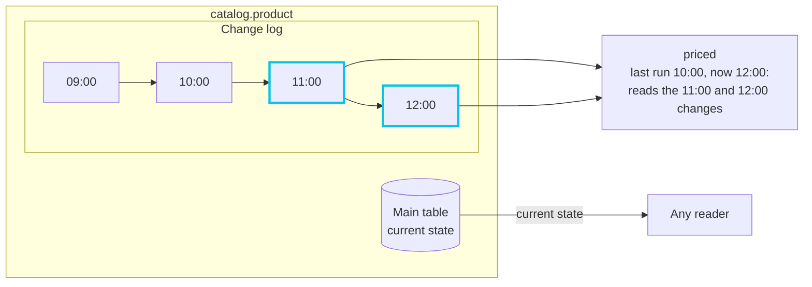

# Trickles

A Ripple normally rewrites its tables in full on every run, and every Ripple downstream reads them in full. When a large table changes by a few rows between runs, most of that work is repeated for nothing. A **Trickle** is a table that keeps a record of its changes, so that downstream Ripples can process only what changed since they last ran.

The Playground works through the ideas on this page with a small pipeline you can run in the browser: https://playground.duckstring.com/trickle

## Structure

Any Ripple can write a Trickle; it's a choice made per table when writing it. Each change is stored as a row with a weight: `+1` for a row added and `-1` for a row removed. An update is a removal of the old row plus an addition of the new one. When the price of product 42 in `catalog` moves from 10.00 to 12.00, the change is recorded as:

| product_id | unit_price | weight |
|---|---|---|
| 42 | 10.00 | -1 |
| 42 | 12.00 | +1 |

A set of rows with weights like this is called a **Z-set**. Weights make changes behave like ordinary arithmetic:

- Combining changes is addition. The weights of identical rows are summed, and a row whose weights sum to zero doesn't exist. Adding the change above to a table that contains the 10.00 row removes that row and adds the 12.00 one.
- Joining is multiplication. A joined row's weight is the product of the weights of the rows it came from. An order line for product 42 (`+1`) joined to the removed 10.00 catalog row (`-1`) gives `-1`, so the old priced order line is removed from the result without any special handling.

So you can think of appends as addition and joins as multiplication, even when deletes and updates are involved. Every change carries the whole row, so its effect can be worked out without looking anything up elsewhere.

Every change is stamped with the freshness of the run that made it. When a downstream Ripple runs, it reads just the changes between its previous run and this one. On its first run, or if it has fallen too far behind, it reads the whole table instead.

## Append and Merge

There are two kinds of Trickle, chosen by how the table changes:

| | Append | Merge |
|---|---|---|
| Suited to | event streams, logs, facts that never change once written | dimensions and any table whose rows change |
| Each run writes | only the new rows | the complete current state, with a primary key |
| Changes recorded | the new rows, all `+1` | the difference from the previous state, worked out by Duckstring |
| Demo example | `orders` | `catalog` |

With a merge, you never have to track changes yourself. The Ripple writes the table as it should look now, and Duckstring compares it with the previous state to find the rows that were inserted, updated or deleted. This also helps when a Ripple has to recompute everything anyway: `revenue` recalculates its totals in full each run, but because it writes them with a merge, downstream Ponds only see the products whose totals actually moved.

## Change Types

Some transformations can be updated from the changes alone, and some can't. Duckstring maintains the first kind incrementally and falls back to a full recompute for the rest.

### Distributive and Algebraic

A distributive aggregation, such as a sum or count, can be updated by adding the effect of the changed rows to the previous result. An algebraic one, such as a mean or variance, is derived from a few distributive values (a mean is a sum divided by a count), so it can be updated the same way. Duckstring keeps these intermediate values for each group and adjusts only the groups a change touches. Minimums and maximums extend easily when rows are added; when a row is removed, the affected group is rescanned.

Holistic aggregations, such as medians, percentiles and distinct counts, need the whole group to compute, so they are recomputed in full.

### Aggregation and Accumulation

An **aggregation** reduces each group to one row, and the order of the rows doesn't matter. Total revenue per product, maintained from `priced` as order lines arrive and prices change:

```python
from duckstring import agg

(
    pond.trickle("priced.priced_line")
    .aggregate(by="product_id",
               total_revenue=agg.sum("revenue"),
               mean_quantity=agg.mean("quantity"))
    .merge("revenue_by_product")
)
```

An **accumulation** adds a running value to every row, in the order of a column you choose with `.along(...)`: a running total, a moving average, the previous row's value. Each store's running unit count, in order of when orders were placed:

```python
from duckstring import acc

(
    pond.trickle("orders.order_line")
    .along("ordered_at")
    .accumulate(by="store_id", running_units=acc.sum("quantity"))
    .merge("store_running_units", pk="order_id")
)
```

Accumulations remember where each group left off, so new rows at the end of a group continue from that point instead of rescanning the group.

## Compute Minimisation

### DBSP

Without help, publishing changes incrementally costs two full passes over the data. The Ripple recomputes its whole output, then compares it with the previous state to work out which rows were inserted, updated or deleted. `revenue` does exactly this with a merge. Both steps grow with the size of the table, however small the change.

DBSP, a theory of incremental computation over Z-sets, removes both.

First, it computes the change to the output directly from the changes to the inputs, and that change is already a Z-set. Duckstring appends it to the change log as it is. The weights already say what was added and what was removed, so there is no need to search the existing table to classify each row.

Second, it shows which parts of the computation are needed at all. Write each table after a run as its previous state plus its changes, $A + \Delta A$. A join then expands like a product:

$$
(A + \Delta A) \bowtie (B + \Delta B) = A \bowtie B \;+\; \Delta A \bowtie B \;+\; A \bowtie \Delta B \;+\; \Delta A \bowtie \Delta B
$$

The first term, the unchanged part of each table joined together, is the previous output, which is already stored. So the change to the output is just the other three terms:

$$
\Delta(A \bowtie B) = \Delta A \bowtie B \;+\; A \bowtie \Delta B \;+\; \Delta A \bowtie \Delta B
$$

| | $B$ | $\Delta B$ |
|---|---|---|
| $A$ | already stored, never computed | computed |
| $\Delta A$ | computed | computed |

Every remaining term involves at least one set of changes, which is small next to the tables themselves. Because weights multiply, a deletion or update on either side produces the right removals in the output, so the rule holds for every kind of change. Similar rules cover filters, computed columns and aggregations. Together they let Duckstring maintain results incrementally with confidence, instead of relying on hand-written logic that has to anticipate every way the inputs might change.

The last term matters when both tables change at the same key. Suppose an order line and the product it refers to are both deleted in one run. Their joined row was in the previous output and should be removed once:

| Term | Weights | Result |
|---|---|---|
| $\Delta A \bowtie B$ | $-1 \times +1$ | $-1$ |
| $A \bowtie \Delta B$ | $+1 \times -1$ | $-1$ |
| $\Delta A \bowtie \Delta B$ | $-1 \times -1$ | $+1$ |
| Total | | $-1$ |

Each deletion, joined with the other table's previous state, removes the joined row, so together they remove it twice, and the last term adds one back. This is the same arithmetic as $(1 - 1) \times (1 - 1) - 1 \times 1 = -1$: the new output has no such row, and the previous one had one. Duckstring evaluates the same change against the tables as they are after the run, $A' = A + \Delta A$ and $B' = B + \Delta B$, as $\Delta A \bowtie B' + A' \bowtie \Delta B - \Delta A \bowtie \Delta B$, so it never has to rebuild an earlier version of a table. There the arithmetic is $0 + 0 - (+1)$: neither deleted row is left in a table to pair with, and the overlap of the two changes is subtracted.

### Changed Key Set

Each remaining term joins a set of changes to a table, and a row of the table can only take part if its key appears in those changes. So $A \bowtie \Delta B$ only involves the rows of $A$ whose keys appear in $\Delta B$: when `priced` joins order lines to the catalog and 100 products change price, only the order lines for those 100 products take part.

Semi, anti and outer joins also depend on whether a key has any match at all. Only a key in the changes can gain its first match or lose its last, so Duckstring counts matches for those keys and adjusts just the rows that hold them. When one side of a join is itself a join, the changed keys are passed down to the table that holds them, so that join doesn't run over its whole input first.

If a large fraction of a source changes (by default, more than 30% of its rows), filtering by key stops being worthwhile, and Duckstring recomputes that part of the result in full. It still records only the difference, so downstream Ponds still receive just the changes.

A source can also be an ordinary table, which keeps no record of its changes. When it changes, the result is recomputed in full; when it hasn't, it contributes nothing. The Pond that writes it can check each new version against the one it last published and keep the published copy when nothing differs, so a re-run that produces the same table doesn't count as a change downstream.

## Builder

Writing these rules by hand is error-prone, so Duckstring provides a query builder, `pond.trickle(...)`, that applies them for you. This is the whole of the `priced` Ripple:

```python
(
    pond.trickle("orders.order_line")
    .join(pond.trickle("catalog.product"), on="product_id")
    .select("s0.order_id, s0.product_id, s0.quantity, s1.unit_price, "
            "round(s0.quantity * s1.unit_price, 2) AS revenue")
    .merge("priced_line", pk="order_id")
)
```

The builder supports joins of every type, filters, computed columns, aggregations and accumulations, all maintained incrementally. Anything else can be written as plain SQL with `.sql(...)`. That part is recomputed in full, but its output is still written as changes.

## Data

A consumer reading a Trickle with `read_table` sees an ordinary table: the current state, without weights or freshness stamps. The change history is stored alongside it.



Each run of `catalog` adds its changes to the log, stamped with the run's freshness. `priced` last ran at 10:00 and is now running at 12:00, so it reads only the changes stamped 11:00 and 12:00.

### Main Table

The main table holds the current state, one row per primary key for a merge. It's what `read_table` returns and what the data viewer shows.

<figure class="ds-figure">
  
  <figcaption>The data viewer on <code>catalog.product</code>. Each row shows the freshness of the run that last changed it and how many times it has changed, and the Freshness bounds narrow the view to rows changed between two runs.</figcaption>
</figure>

### Merge Change Logs

Each merge run appends its changes, as weighted rows, to a change log published with the table. A downstream Ripple reads the part of the log that falls in its window.

### Append Tables

An append table needs no separate log, since every row it holds was added by some run. Its history is its change log: the rows stamped within a consumer's window are the changes.

### Consolidation

When a consumer reads a window covering several runs, the changes are consolidated first: weights for identical rows are summed, and rows that sum to zero disappear. If product 42 went from 10.00 to 12.00 and back to 10.00 within the window, the consumer sees no change at all.

### Compaction

A change log can't grow forever. As it gets large, Duckstring folds older changes into consolidated batches, and eventually into the main table itself, keeping recent changes available for consumers that are keeping up. A consumer that falls behind what's still retained reads the whole table instead, so compaction affects cost, never correctness. The compacted table is stored ordered by its primary key, or by columns you choose, so reads that filter on them skip most of it.

## See also

- Guides: [Append and Merge Tables](../guides/append_and_merge.md), [Joins with the Builder](../guides/joins_with_the_builder.md), [Aggregation and Accumulation](../guides/aggregation_and_accumulation.md)
- Reference: [Trickle I/O](../reference/python/trickle_io.md), [Trickle Builder](../reference/python/trickle_builder.md), [agg](../reference/python/agg.md), [acc](../reference/python/acc.md)
