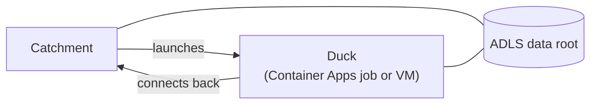

# Cloud Compute on Azure

By default a Catchment runs every Pond on its own machine. With cloud compute set up, individual Ponds can instead run on Azure Container Apps jobs or Azure VMs, in your own subscription, while the Catchment stays where it is. This guide sets that up. Everything here is configuration: a Pond asking for cloud compute on a Catchment without it simply runs locally, so the same `pond.toml` works everywhere.

## How it fits together



The Catchment launches a Duck for a Pond when it needs to run, and the Duck connects back to the Catchment for its work. Connections only ever go from the Duck to the Catchment, so Ducks need no inbound network access, only outbound access to the Catchment and to storage. Published tables live in Azure storage, where every Duck can reach them.

Cloud compute turns on when both of these hold:

1. The Catchment's data root is in Azure storage (`abfss://` or `az://`).
2. The Catchment has Azure credentials: a managed identity, a service principal (`AZURE_TENANT_ID`, `AZURE_CLIENT_ID` and `AZURE_CLIENT_SECRET`, as environment variables or all three as secrets), workload identity, or an `az login`.

```bash
duckstring catchment settings
```

```text
data root:  abfss://lake@acmelake.dfs.core.windows.net/duckstring
cloud:      Azure
creds:      yes
compute:    enabled
```

A Catchment runs cloud Ducks only on its data root's cloud. A pipeline that spans clouds is a Catchment on each, joined by [ducts](connecting_catchments.md).

## Step 1: the data root

Use an ADLS Gen2 storage account, which is a storage account with hierarchical namespace turned on:

```bash
duckstring catchment settings --data-root 'abfss://lake@acmelake.dfs.core.windows.net/duckstring'
```

The data root can only be set before any Pond has published data, since changing it later would strand that data. With managed identities, as below, the URI needs no credentials. [Data root URIs](../reference/formats.md#data-root-uris) lists the other forms.

## Step 2: identities

Two user-assigned managed identities are involved, one for the Catchment and one for its Ducks. Ducks never receive the Catchment's identity.

**The Catchment's identity** launches Ducks and reads the data root:

- Contributor on the resource group the Ducks run in.
- Managed Identity Operator on the Duck identity, so it can give that identity to a job or VM.
- Storage Blob Data Contributor on the storage account.
- AcrPull on the container registry, if the Duck image is in one.

**The Duck's identity** needs Storage Blob Data Contributor on the storage account, plus AcrPull if the image is in a registry of yours, and nothing else.

:::warning[The data role is separate]
Owner and Contributor don't grant access to the data in a storage account. Without Storage Blob Data Contributor, an identity that can manage the account still can't read or write its tables.
:::

A Catchment running somewhere other than Azure, such as a laptop, can use a service principal with the same roles instead of a managed identity.

## Step 3: resource providers

The subscription must have these resource providers registered:

- `Microsoft.App` and `Microsoft.OperationalInsights`, for Container Apps.
- `Microsoft.Compute` and `Microsoft.Network`, for VMs.
- `Microsoft.ContainerRegistry`, if you keep the image in a registry.

```bash
az provider register --namespace Microsoft.App
```

:::warning[Subscription rights are needed]
Registering a provider is a subscription-level action. A principal whose roles are scoped to a resource group can't do it, so someone with rights on the subscription has to register them once.
:::

## Step 4: reaching the Catchment

Ducks connect back to the address the Catchment is bound to. If that address isn't reachable from where the Ducks run, set the address they should use:

```bash
DUCKSTRING_CATCHMENT_PUBLIC_URL=https://catchment.example.com
```

On AWS a Catchment on a laptop can run cloud Ducks through a relay. Azure has no relay, so a Catchment there needs an address Ducks can reach. In practice that means running the Catchment in Azure, as described in [Running the Catchment on Azure](#running-the-catchment-on-azure).

Ducks also need outbound access to storage. A Duck for a Pond with its own [Python dependencies](writing_ripples.md#python-dependencies) builds that environment when it starts, so it needs a route to PyPI too.

## Step 5a: Container Apps Ducks

Container Apps is the default backend. Each Duck runs as one execution of a Container Apps job, which reaches its first Ripple in about 20 to 40 seconds from a cold start.

Create a Container Apps environment (the consumption profile is enough, and it comes with a Log Analytics workspace), then point the Catchment at it and at the Duck identity:

```bash
DUCKSTRING_CONTAINERAPPS_ENVIRONMENT=/subscriptions/<sub>/resourceGroups/duckstring/providers/Microsoft.App/managedEnvironments/duckstring-env
DUCKSTRING_CONTAINERAPPS_IDENTITY=/subscriptions/<sub>/resourceGroups/duckstring/providers/Microsoft.ManagedIdentity/userAssignedIdentities/duckstring-duck
```

Both are resource ids. The subscription, resource group, location and log workspace all come from the environment. Optional settings:

| Variable | Default | Description |
|---|---|---|
| `DUCKSTRING_CONTAINERAPPS_IMAGE` | the release's `-azure` image | The Duck image. |
| `DUCKSTRING_CONTAINERAPPS_WORKLOAD_PROFILE` | `Consumption` | The environment's workload profile to run Ducks on. |
| `DUCKSTRING_CONTAINERAPPS_JOB` | none | A job name of your own, instead of the one the Catchment generates. |

Then move a Pond onto it, using one of the built-in sizes:

```bash
duckstring duck set sales --duck M
duckstring refresh now sales
```

Or declare it in the Pond's `pond.toml`, so it travels with the code:

```toml
[pond]
duck = "M"
```

| Size | vCPU | Memory |
|---|---|---|
| `S` | 0.5 | 1 GiB |
| `M` | 1 | 2 GiB |
| `L` | 2 | 4 GiB |
| `XL` | 4 | 8 GiB |

These follow the consumption profile, which allows 2 GiB per vCPU, up to 4 vCPU and 8 GiB. For a Pond that needs more, use a VM (below).

Each Pond on a built-in size gets its own execution. A pool you define instead runs all of its Ponds' Ducks on one shared machine of its size. Sizes are in the same units on every cloud, `--cpu` in 1024ths of a vCPU and `--memory` in MiB:

```bash
duckstring duck pool add shared --cpu 2048 --memory 4096
```

The Catchment creates the Container Apps jobs itself, one per configuration, named `duckstring-duck-<hash>` and tagged with the Catchment. When an upgrade brings a new image, it deletes its own jobs on the old image once nothing is running on them. A job named with `DUCKSTRING_CONTAINERAPPS_JOB` is never deleted.

### The Duck image

Each release of Duckstring publishes an Azure Duck image at `ghcr.io/duckstring-dev/duckstring`, tagged with its version and `-azure` (for example `0.8.0-azure`). A Duck and its Catchment must run the same Duckstring, so the Catchment uses the tag that matches its own version unless you set `DUCKSTRING_CONTAINERAPPS_IMAGE`. Container Apps pulls it from ghcr directly.

The image includes DuckDB's Azure extension, so Ducks don't need to download it when they start.

A Duck downloads its Pond's code from the Catchment when it starts. A Pond that declares its own Python dependencies has its environment built at the same time, on every cold start.

### Building your own image

Build your own image when Ponds without a `pyproject.toml` import packages the published image doesn't have, or need system libraries. The repository's `Dockerfile` builds the published image; pass the Azure extra to it:

```bash
docker build --platform linux/amd64 --build-arg EXTRAS=azure -t duckstring:0.8.0-azure .
```

[Cloud Compute on AWS](cloud_compute_on_aws.md#building-your-own-image) covers installing extra packages so that Pond environments reuse them. Push the image to an Azure Container Registry, and give both identities AcrPull on it. Container Apps pulls an ACR image with the Duck identity.

:::note[ACR cloud builds]
`az acr build` can be blocked on some subscriptions, failing with `TasksOperationsNotAllowed`. Building locally and pushing with `docker push` works on those too.
:::

## Step 5b: VM Ducks

Azure VMs suit sizes Container Apps doesn't offer, GPUs, or a particular VM size. Each Duck gets its own VM, which boots Ubuntu 24.04, installs Duckstring from PyPI with uv and starts the Duck. That takes about a minute, and the Catchment allows for it before treating a Duck as unresponsive.

```bash
DUCKSTRING_AZUREVM_SUBNET=/subscriptions/<sub>/resourceGroups/duckstring/providers/Microsoft.Network/virtualNetworks/duckstring-vnet/subnets/ducks
DUCKSTRING_AZUREVM_IDENTITY=/subscriptions/<sub>/resourceGroups/duckstring/providers/Microsoft.ManagedIdentity/userAssignedIdentities/duckstring-duck
DUCKSTRING_AZUREVM_LOCATION=australiaeast
```

```bash
duckstring duck pool add heavy --provider azurevm --instance-type Standard_E8s_v5
duckstring duck set sales --duck heavy
```

| Variable | Default | Description |
|---|---|---|
| `DUCKSTRING_AZUREVM_RESOURCE_GROUP` | the subnet's | Where the VMs are created. |
| `DUCKSTRING_AZUREVM_IMAGE` | Ubuntu 24.04 | A marketplace URN or an image resource id. |
| `DUCKSTRING_AZUREVM_ASSIGN_PUBLIC_IP` | `true` | Give each VM a public IP for outbound access. |
| `DUCKSTRING_AZUREVM_PIP_SPEC` | `duckstring[azure]==<version>` | What the VM installs. |
| `DUCKSTRING_AZUREVM_DISK_GB` | the image's | OS disk size. |

Without an instance type, a VM is a `Standard_D2s_v5`.

:::warning[VMs need internet access]
A VM downloads uv, Python and Duckstring when it boots. New Azure subnets have no default outbound access, which is why each VM gets a public IP by default. If you set `DUCKSTRING_AZUREVM_ASSIGN_PUBLIC_IP=false`, give the subnet a NAT gateway or another route out.
:::

An Azure VM whose operating system has shut down is still allocated and still billed. The Catchment therefore deletes a Duck's VM, with its disk, network interface and IP, once the Duck has finished. After a restart, its first VM launch deletes any of its VMs it finds stopped, and when the Catchment shuts down it deletes the VMs it started.

## Running the Catchment on Azure

A Catchment can run as a Container App. This configuration was tested end to end:

- One replica.
- External ingress on port 7474.
- The Catchment identity assigned to the app, with `AZURE_CLIENT_ID` set to its client id.
- An API key stored as a Container Apps secret and passed as `DUCKSTRING_API_KEY`.
- `DUCKSTRING_CATCHMENT_PUBLIC_URL` set to the app's own `https://<app>.<env>.<region>.azurecontainerapps.io` address.
- The Container Apps and VM settings above, as environment variables.
- This command:

```bash
duckstring catchment init --name prod --host 0.0.0.0 --data-root 'abfss://lake@acmelake.dfs.core.windows.net/duckstring' --yes --no-start \
  && exec duckstring catchment start prod
```

A container loses its filesystem when it restarts, and the Catchment's own state (its database of Ponds, runs and settings) lives there. Give it a state backup with `DUCKSTRING_STATE_BACKUP_URI`, as described in [Hosting on a Platform](hosting_on_a_platform.md#keeping-state).

## Where data goes

A Pond running on the Catchment's own machine publishes locally first, then copies its output to the data root in the background. A Pond on a cloud Duck publishes straight to the data root. A Pond downstream on a different machine waits until its Source's output has reached the data root, never reading output that isn't there yet.

To stop the Catchment without repeating recent work on restart, drain it first:

```bash
duckstring control sleep --all
```

## Debugging a Duck

**Start with the Pond's failure message.** When a Duck fails, the Catchment asks Azure what happened and includes it. For Container Apps that is the execution's status, its container events (such as an image pull failure or an exit code) and the end of its console log. These come from Log Analytics, which receives them a few minutes late, so a failure right after a Duck starts may not include them yet.

To watch a Container Apps Duck's output live:

```bash
az containerapp job logs show -n <job> -g <resource-group> --execution <execution> --container duck --follow
```

A VM Duck that died before connecting leaves its boot output on the serial console, which the failure message also quotes:

```bash
az vm boot-diagnostics get-boot-log -g <resource-group> -n <vm>
```

Duck VMs have no inbound access, and their SSH key is one nobody holds. Don't add one: a Duck holds credentials for your data.

## Cost

Duckstring itself costs nothing; you pay Azure for:

- the Catchment's machine or Container App, which runs continuously and is most of a small deployment's cost;
- Ducks, per run, since each is stopped when its Pond goes idle (a Pond with a recurring Refresh keeps its Duck warm, and a Duck that loses its Catchment stops itself after an hour idle; see `DUCKSTRING_DUCK_ORPHAN_MINUTES`);
- the Log Analytics workspace, and the container registry if you use one;
- storage and transactions.

## Checklist

If cloud Ducks don't start:

- [ ] `duckstring catchment settings` shows `compute: enabled`
- [ ] Both identities have Storage Blob Data Contributor on the storage account
- [ ] The Catchment's identity has Contributor on the Ducks' resource group and Managed Identity Operator on the Duck identity
- [ ] The resource providers are registered on the subscription
- [ ] The Ducks can reach the Catchment's address, or `DUCKSTRING_CATCHMENT_PUBLIC_URL` is set
- [ ] An image in ACR has AcrPull granted to the Duck identity
- [ ] An image you set yourself matches the Catchment's version
- [ ] VM Ducks have a public IP or another route to the internet
