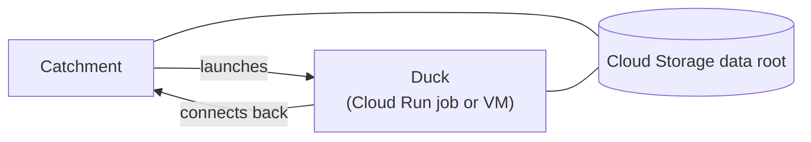

# Cloud Compute on Google Cloud

By default a Catchment runs every Pond on its own machine. With cloud compute set up, individual Ponds can instead run on Cloud Run jobs or Compute Engine VMs, in your own project, while the Catchment stays where it is. This guide sets that up. Everything here is configuration: a Pond asking for cloud compute on a Catchment without it simply runs locally, so the same `pond.toml` works everywhere.

## How it fits together



The Catchment launches a Duck for a Pond when it needs to run, and the Duck connects back to the Catchment for its work. Connections only ever go from the Duck to the Catchment, so Ducks need no inbound network access, only outbound access to the Catchment and to Cloud Storage. Published tables live in a bucket, where every Duck can reach them.

Cloud compute turns on when both of these hold:

1. The Catchment's data root is in Cloud Storage (`gs://`).
2. The Catchment has Google credentials: the service account of the machine it runs on (on Cloud Run or Compute Engine), `GOOGLE_APPLICATION_CREDENTIALS`, a `gcloud auth application-default login`, or a service-account key stored as the `GOOGLE_CREDENTIALS` secret.

```bash
duckstring catchment settings
```

```text
data root:  gs://acme-lake/duckstring
cloud:      Google Cloud
creds:      yes
compute:    enabled
```

A Catchment runs cloud Ducks only on its data root's cloud. A pipeline that spans clouds is a Catchment on each, joined by [ducts](connecting_catchments.md).

## Step 1: the data root

```bash
duckstring catchment settings --data-root 'gs://acme-lake/duckstring'
```

The data root can only be set before any Pond has published data, since changing it later would strand that data. Prefer the credentials of the Catchment's service account over a key in the URI. [Data root URIs](../reference/formats.md#data-root-uris) lists the options.

A Catchment outside Google Cloud can use a service-account key. Store it as a secret, with the project beside it:

```bash
duckstring secret set GOOGLE_CREDENTIALS      # paste the key's JSON
duckstring secret set GOOGLE_CLOUD_PROJECT
```

The Catchment writes the key to a private file next to its secret store, and never includes it in a Catchment download or state backup.

## Step 2: service accounts

Two service accounts are involved, one for the Catchment and one for its Ducks. Ducks never receive the Catchment's credentials.

**The Catchment's service account** launches Ducks and reads the bucket:

- `roles/run.admin`, for Cloud Run Ducks.
- `roles/compute.instanceAdmin.v1`, for Compute Engine Ducks.
- `roles/logging.viewer`, to quote a Duck's logs when it fails.
- `roles/artifactregistry.reader`, for the Duck image.
- `roles/storage.objectAdmin` on the bucket.
- `roles/iam.serviceAccountUser` on the Duck service account, so it can run jobs and VMs as that account.

These are the roles that were tested. Narrower ones may work.

**The Duck's service account** needs `roles/storage.objectAdmin` on the bucket and nothing else, unless the Catchment is a private Cloud Run service (see [A private Catchment](#a-private-catchment)).

The project also needs the Cloud Run, Compute Engine and Artifact Registry APIs enabled.

## Step 3: reaching the Catchment

Ducks connect back to the address the Catchment is bound to. If that address isn't reachable from where the Ducks run, set the address they should use:

```bash
DUCKSTRING_CATCHMENT_PUBLIC_URL=https://catchment-123456789.australia-southeast1.run.app
```

On AWS a Catchment on a laptop can run cloud Ducks through a relay. Google Cloud has no relay, so a Catchment there needs an address Ducks can reach. In practice that means running the Catchment in Google Cloud, as described in [Running the Catchment on Cloud Run](#running-the-catchment-on-cloud-run).

A Duck for a Pond with its own [Python dependencies](writing_ripples.md#python-dependencies) builds that environment when it starts, so it also needs a route to PyPI.

## Step 4a: Cloud Run Ducks

Cloud Run is the default backend, and the fastest to start: a Duck reaches its first Ripple in about 15 seconds from a cold start. Each Duck runs as one execution of a Cloud Run job.

Cloud Run pulls images only from Artifact Registry (or Docker Hub), so it can't pull the published Duck image from ghcr directly. The simplest route is an Artifact Registry remote repository that proxies ghcr:

```bash
gcloud artifacts repositories create ghcr --repository-format=docker --location=australia-southeast1 \
  --mode=remote-repository --remote-docker-repo=https://ghcr.io
```

Then point the Catchment at it, with the region and the Duck service account:

```bash
DUCKSTRING_CLOUDRUN_REGION=australia-southeast1
DUCKSTRING_CLOUDRUN_SERVICE_ACCOUNT=duckstring-duck@acme-data.iam.gserviceaccount.com
DUCKSTRING_CLOUDRUN_REGISTRY=australia-southeast1-docker.pkg.dev/acme-data/ghcr
```

The Catchment then runs `<registry>/duckstring-dev/duckstring:<version>-gcp`, the image matching its own version. To use an image you pushed to Artifact Registry yourself, set `DUCKSTRING_CLOUDRUN_IMAGE` to it instead of the registry. Optional settings:

| Variable | Default | Description |
|---|---|---|
| `DUCKSTRING_CLOUDRUN_PROJECT` | `GOOGLE_CLOUD_PROJECT`, else the credentials' project | The project the jobs run in. |
| `DUCKSTRING_CLOUDRUN_JOB` | none | A job name of your own, instead of the one the Catchment generates. |

Then move a Pond onto it, using one of the built-in sizes:

```bash
duckstring duck set sales --duck M
duckstring refresh now sales
```

Or declare it in the Pond's `pond.toml`, so it travels with the code:

```toml
[pond]
duck = "M"
```

| Size | vCPU | Memory |
|---|---|---|
| `S` | 1 | 2 GiB |
| `M` | 1 | 4 GiB |
| `L` | 2 | 8 GiB |
| `XL` | 4 | 16 GiB |

Cloud Run jobs go up to 8 vCPU and 32 GiB. For a Pond that needs more, use a VM (below).

Each Pond on a built-in size gets its own execution. A pool you define instead runs all of its Ponds' Ducks on one shared machine of its size. Sizes are in the same units on every cloud, `--cpu` in 1024ths of a vCPU and `--memory` in MiB:

```bash
duckstring duck pool add shared --cpu 4096 --memory 16384
```

The Catchment creates the Cloud Run jobs itself, named `duckstring-duck-<hash>` and tagged with the Catchment. Cloud Run can't change one execution's CPU or memory, so there is a job for each size as well as each configuration. When an upgrade brings a new image, the Catchment deletes its own jobs on the old image once nothing is running on them. A job named with `DUCKSTRING_CLOUDRUN_JOB` is never deleted.

### The Duck image

Each release of Duckstring publishes a Google Duck image at `ghcr.io/duckstring-dev/duckstring`, tagged with its version and `-gcp` (for example `0.8.0-gcp`). A Duck and its Catchment must run the same Duckstring, so pin the tag that matches the Catchment's version. The image includes the DuckDB extension that reads Cloud Storage, so Ducks don't need to download it when they start.

A Duck downloads its Pond's code from the Catchment when it starts. A Pond that declares its own Python dependencies has its environment built at the same time, on every cold start.

### Building your own image

Build your own image when Ponds without a `pyproject.toml` import packages the published image doesn't have, or need system libraries. The repository's `Dockerfile` builds the published image; pass the Google extra to it:

```bash
docker build --platform linux/amd64 --build-arg EXTRAS=gcp -t duckstring:0.8.0-gcp .
```

[Cloud Compute on AWS](cloud_compute_on_aws.md#building-your-own-image) covers installing extra packages so that Pond environments reuse them. Push the image to a standard Artifact Registry repository and set `DUCKSTRING_CLOUDRUN_IMAGE` to its path.

## Step 4b: Compute Engine Ducks

Compute Engine suits sizes Cloud Run doesn't offer, GPUs, or a particular machine type. Each Duck gets its own VM, which boots Ubuntu 24.04, installs Duckstring from PyPI with uv and starts the Duck. That takes about a minute, and the Catchment allows for it before treating a Duck as unresponsive.

```bash
DUCKSTRING_GCE_ZONE=australia-southeast1-a
DUCKSTRING_GCE_SERVICE_ACCOUNT=duckstring-duck@acme-data.iam.gserviceaccount.com
```

```bash
duckstring duck pool add heavy --provider gce --instance-type n2-highmem-8
duckstring duck set sales --duck heavy
```

| Variable | Default | Description |
|---|---|---|
| `DUCKSTRING_GCE_PROJECT` | `GOOGLE_CLOUD_PROJECT`, else the credentials' project | The project the VMs run in. |
| `DUCKSTRING_GCE_IMAGE` | Ubuntu 24.04 | The boot image. |
| `DUCKSTRING_GCE_NETWORK` | `default` | The VPC network. |
| `DUCKSTRING_GCE_SUBNETWORK` | none | A subnetwork of that network. |
| `DUCKSTRING_GCE_ASSIGN_PUBLIC_IP` | `true` | Give each VM an external IP for outbound access. |
| `DUCKSTRING_GCE_PIP_SPEC` | `duckstring[gcp]==<version>` | What the VM installs. |
| `DUCKSTRING_GCE_DISK_GB` | `20` | Boot disk size. |

Without an instance type, a VM is an `e2-standard-2`.

:::warning[VMs need internet access]
A VM downloads uv, Python and Duckstring when it boots. The project's default network has no Cloud NAT, which is why each VM gets an external IP by default. If you set `DUCKSTRING_GCE_ASSIGN_PUBLIC_IP=false`, give the network a Cloud NAT or another route out.
:::

A stopped Compute Engine VM no longer bills for its CPU, but its disk is still billed. The Catchment therefore deletes a Duck's VM, with its disk, once the Duck has finished. After a restart, its first VM launch deletes any of its VMs it finds stopped, and when the Catchment shuts down it deletes the VMs it started.

## Running the Catchment on Cloud Run

A Catchment can run as a Cloud Run service. This configuration was tested end to end:

- Exactly one instance (minimum and maximum 1).
- CPU always allocated (`run.googleapis.com/cpu-throttling: false`), since the Catchment's scheduler runs between requests.
- Port 7474.
- The Catchment service account as the service's identity.
- 4 GiB of memory, since a Cloud Run instance's filesystem is held in memory.
- `DUCKSTRING_CATCHMENT_PUBLIC_URL` set to its `https://<service>-<project number>.<region>.run.app` address.
- The Cloud Run and Compute Engine settings above, as environment variables.
- This command:

```bash
duckstring catchment init --name prod --host 0.0.0.0 --data-root 'gs://acme-lake/duckstring' --yes --no-start \
  && exec duckstring catchment start prod
```

Deleting the service stops the Catchment cleanly within Cloud Run's 10-second shutdown window, including deleting its VMs.

A container loses its filesystem when it restarts, and the Catchment's own state (its database of Ponds, runs and settings) lives there. Give it a state backup with `DUCKSTRING_STATE_BACKUP_URI`, as described in [Hosting on a Platform](hosting_on_a_platform.md#keeping-state).

### A private Catchment

A Cloud Run service can admit only callers with a Google identity, so the Catchment isn't open to the internet at all. Ducks support this: when the Catchment's address is the service's `*.run.app` URL, Ducks send their service account's identity token in the `X-Serverless-Authorization` header, which Cloud Run checks. Grant the Duck service account `roles/run.invoker` on the service.

With a custom domain in front of the service, Ducks can't tell from the address that they need a token. Set `DUCKSTRING_CATCHMENT_AUDIENCE` on the Catchment to the service's `run.app` URL, which is the audience Cloud Run expects, and the Catchment passes it to every Duck it starts:

```bash
DUCKSTRING_CATCHMENT_PUBLIC_URL=https://catchment.acme.com
DUCKSTRING_CATCHMENT_AUDIENCE=https://catchment-123456789.australia-southeast1.run.app
```

From a laptop, connect with both the Catchment's API key and your own identity token:

```bash
duckstring catchment connect --name gcp --path https://catchment-123456789.australia-southeast1.run.app --key <key> \
  --header-command "X-Serverless-Authorization: gcloud auth print-identity-token --audiences=https://catchment-123456789.australia-southeast1.run.app"
```

An identity token lasts an hour, and the CLI runs the command again when it's about to expire.

## Where data goes

A Pond running on the Catchment's own machine publishes locally first, then copies its output to the bucket in the background. A Pond on a cloud Duck publishes straight to the bucket. A Pond downstream on a different machine waits until its Source's output has reached the bucket, never reading output that isn't there yet.

To stop the Catchment without repeating recent work on restart, drain it first:

```bash
duckstring control sleep --all
```

## Debugging a Duck

**Start with the Pond's failure message.** When a Duck fails, the Catchment asks Google Cloud what happened and includes it: the execution's state and the end of its Cloud Logging entries for Cloud Run, or the VM's status and the end of its serial console for Compute Engine.

A VM Duck that died before connecting leaves its boot output on the serial console:

```bash
gcloud compute instances get-serial-port-output <vm> --zone australia-southeast1-a
```

Duck VMs have no inbound access. Don't open SSH to them: a Duck holds credentials for your data.

## Cost

Duckstring itself costs nothing; you pay Google Cloud for:

- the Catchment's machine or Cloud Run service, which runs continuously (with CPU always allocated) and is most of a small deployment's cost;
- Ducks, per run, since each is stopped when its Pond goes idle (a Pond with a recurring Refresh keeps its Duck warm, and a Duck that loses its Catchment stops itself after an hour idle; see `DUCKSTRING_DUCK_ORPHAN_MINUTES`);
- Artifact Registry storage for the image;
- Cloud Storage storage and operations.

## Checklist

If cloud Ducks don't start:

- [ ] `duckstring catchment settings` shows `compute: enabled`
- [ ] Both service accounts have `roles/storage.objectAdmin` on the bucket
- [ ] The Catchment's service account has `roles/iam.serviceAccountUser` on the Duck service account
- [ ] `DUCKSTRING_CLOUDRUN_IMAGE` or `DUCKSTRING_CLOUDRUN_REGISTRY` names an Artifact Registry location
- [ ] The Ducks can reach the Catchment's address, or `DUCKSTRING_CATCHMENT_PUBLIC_URL` is set
- [ ] For a private Catchment, the Duck service account has `roles/run.invoker` on the service
- [ ] An image you set yourself matches the Catchment's version
- [ ] VM Ducks have an external IP or another route to the internet
